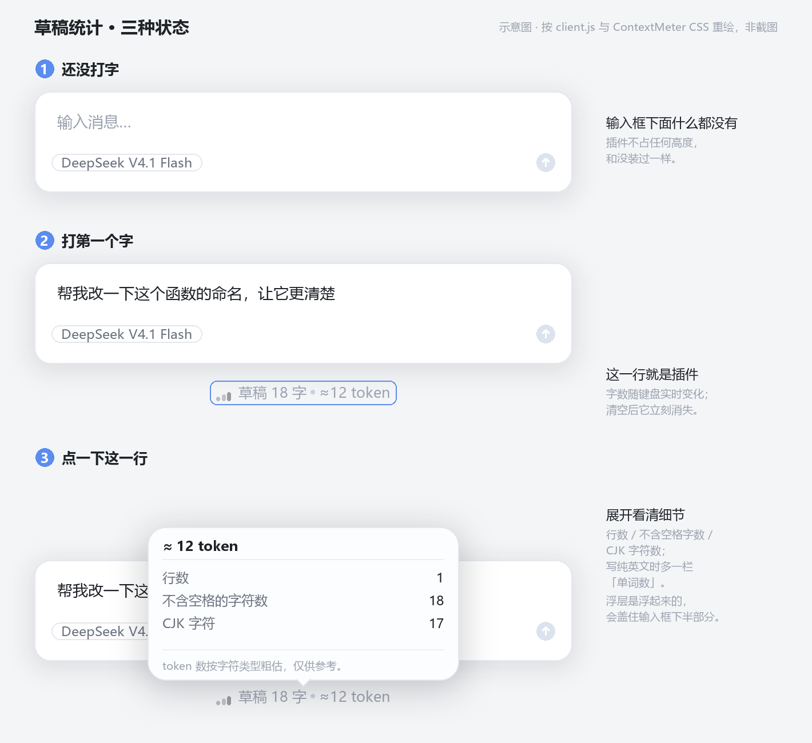

# Draft meter

A DSH plugin that puts one always-visible reading of your message draft under
the composer — characters and an estimated token count — and expands into a
short measurement panel when you click it.



`nothing when empty` → `draft 18 chars · ≈12 tokens` → click for the breakdown.

---

## Why this exists

The composer tells you nothing about what you have written until you send it. You
find out the prompt grew long only after the model answers — or after you have
already scrolled past the part you meant to delete.

The row directly under the composer is the one ambient surface a writer is
already looking at, so the reading lives there. It costs no vertical space while
the draft is empty, and it updates on every keystroke.

The token figure answers **"is this message getting long?"** — not "what will
this cost?". It is a heuristic, and the UI labels it as one.

## What it shows

| Reading | Where | Example |
| --- | --- | --- |
| Characters + estimated tokens | inline, under the composer | `draft 24 chars · ≈7 tokens` |
| Line count | panel | `3` |
| Characters without spaces | panel | `19` |
| Latin words | panel, only when non-zero | `4` |
| CJK characters | panel, only when non-zero | `10` |
| Estimated tokens | panel, marked `≈` | `≈12` |

The glyph at the left of the reading (three ascending bars) is the same visual
language as the shipped activity and usage readings, so the row stays coherent.

## Interaction

- The reading is a **button**: click it, or focus it and press Enter/Space, to
  open the panel anchored above it.
- **Escape** closes the panel. When focus is inside the panel, Escape also
  returns focus to the reading; when focus is still in the editor, Escape closes
  the panel without swallowing the key from the editor.
- An outside click, or tabbing away from the pair, dismisses the panel.
- Scrolling or resizing re-places the panel, so it never drifts away from the
  reading it describes.
- Opening with the mouse leaves the caret and any IME composition untouched.
- An empty draft renders nothing at all, so the dock keeps its default layout. A
  draft of only spaces keeps the reading visible rather than flickering.
- A very long draft ellipsizes the reading instead of pushing the shipped
  activity and usage readings off the row.

## Install

In the DSH Web GUI open **Plugins** → **Add plugin** and give the **absolute
path** to this directory. The package ships a bundle patch
(`cordis.patch.yml`), which the installer requires.

To remove it, open **Plugins**, find *Draft meter* and turn it off; the profile
dependency and the Loader row are both managed by the plugin manager.

## Compatibility

| | |
| --- | --- |
| DSH | 0.2.x (Web GUI, profile bundles) |
| Slot | `conversation.composer.dock` |
| Entry | id `draft-meter`, order `2` — sits after the shipped activity and usage readings |
| Locales | `en`, `zh` (both registered; every string switches with the interface language) |
| Host half | None. `index.js` is an empty `apply()`; the feature is entirely client-side |

No Harness Client package is imported. The only module requests are `react` and
`react-dom` (for the portal), both baseline modules the app already serves, so
nothing needs to be listed under `dsh.client.external`.

## Development

```sh
npm test        # or: node test/run.mjs
```

The suite is dependency-free and needs a bare `node` (18+). It runs 129 checks
in two groups:

- **`test/package.test.mjs`** — the package shape DSH actually reads: manifest
  exports, `dsh.bundle.patch`, `dsh.client.platform`, every `files` entry
  resolving on disk, no `@deepseek-ai` dependency, `client.js` parsing as a
  classic script, the Loader patch naming the package, the locale metadata, the
  artwork rules (no script/`<text>`/`<style>`, no external references, correct
  dimensions), and the one-image detail docs.
- **`test/client.test.mjs`** — activation. It loads `client.js` through a stubbed
  `__ModuleLoader__` against a small React/DOM stub, asserts that the factory has
  no side effects before `apply()`, then runs `apply(ctx)` and inspects what was
  registered: the locale dictionaries (key and placeholder parity between `zh`
  and `en`), the single injected `<style>` (theme tokens only, no literal
  colours, the one-20px-line rule), the dock registration, and the rendered tree
  — empty draft renders nothing, a lone space keeps the reading, singular/plural
  wording, CJK counting, the glyph, the panel portal target, the ARIA wiring, and
  that all four dismissal listeners exist in the capture phase and are removed on
  close.

What the tests **cannot** cover: there is no browser here. The suite proves the
plugin activates and produces the element tree it claims, not how that tree looks
once painted. `docs/states.png` is likewise an illustration drawn from the CSS,
not a screenshot — see [`docs/STATES.md`](docs/STATES.md).

## Layout

```
client.js            the whole feature: measure(), the reading, the panel
index.js             empty Host half (kept so the package is a valid bundle)
cordis.patch.yml     the Loader row the plugin manager installs
locale/{en,zh}.json  plugin-page title, description and detail doc
docs/DETAIL*.md      the one-image plugin-page detail (en + zh)
docs/preview.svg     that image, 640×300, self-contained
docs/states.png      the three-state illustration used by this README
icon.svg             the 36×36 plugin tile
test/                the dependency-free suite above
tools/render-states.py  regenerates docs/states.png (needs Pillow)
```

## License

MIT — see [LICENSE](LICENSE).
